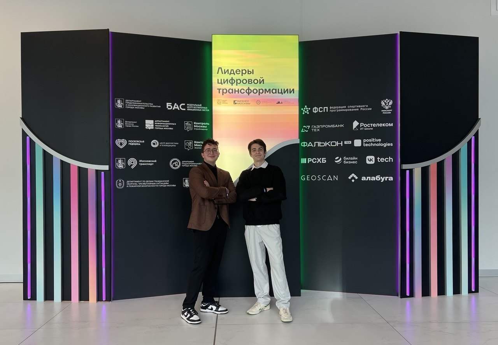

# 🐦‍⬛ Crows from HSE

Студенческая команда МИЭМ НИУ ВШЭ. Участвуем в хакатонах и делаем проекты вместе.

  
   На хакатоне «Лидеры цифровой трансформации 2026»

## Команда

| | GitHub | Роль |
|---|---|---|
| Артемий Корнилов | [@Artem-Kornilov-pro](https://github.com/Artem-Kornilov-pro) | продакт-менеджер |
| Константин Жадько | [@rypleshhh](https://github.com/rypleshhh) | реверс |
| Иван Климович | [@Neonchik4](https://github.com/Neonchik4) | фронтенд |

## Сейчас

**[Хак-контест ФКН × Авито](https://cs.hse.ru/olymp/hackcontest/)**, 27–29 ноября 2026.
Делаем ИИ-агента, который по условию алгоритмической задачи и неверному решению
автоматически находит контр-тест: вход, на котором решение даёт WA, RE или TL.

→ Репозиторий: [`hackcontest-agent`](https://github.com/Crows-from-HSE/hackcontest-agent) (приватный до окончания соревнования)

## Проекты

| Проект | Хакатон | Что это |
|---|---|---|
| [GreenCity](https://github.com/Crows-from-HSE/GreenCity) | «Лидеры цифровой трансформации 2026» | Автоматическое проектирование озеленения города по DXF-плану: учитывает охранные зоны коммуникаций и нормативные отступы, есть 3D-редактор в браузере. Стенд: [baobab24.ru](https://baobab24.ru) |
| [Screen_saver](https://github.com/Crows-from-HSE/Screen_saver) | Сбер × НИУ ВШЭ «Создаём эмоции», трек «Приколы» | Праздничный слой и дудлы поверх главного экрана СберKids: снег, стикер дня, эффекты на события баланса. Сценарии задаются JSON, без релиза приложения |

## Как мы работаем

- Задачи ведём в Issues и в доске проекта, у каждой задачи есть исполнитель.
- В `main` попадаем только через Pull Request с одним ревью.
- Ветки: `feat/…`, `fix/…`, `exp/…` (эксперименты).
- Коммиты в стиле [Conventional Commits](https://www.conventionalcommits.org/ru/): `feat: …`, `fix: …`, `docs: …`.

Подробнее в `CONTRIBUTING.md` каждого репозитория.
